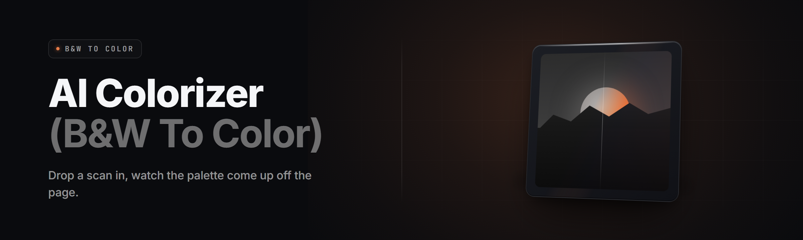

  
  
  

  

  
  
  

---

**AI colorizer (B&W to color) generator** — drop in a black-and-white photo, get a full-color render back in seconds. No cloud. No credits. Runs on your machine.

---

## 🗺️ Table of Contents

- [🖼️ Overview](#️-overview)
- [❓ What is bw-colorizer-ai?](#-what-is-bw-colorizer-ai)
- [🧩 The Problem](#-the-problem)
- [🧪 The Solution](#-the-solution)
- [⚖️ Comparison](#️-comparison)
- [🖌️ Color Correction Modules](#️-color-correction-modules)
- [🧠 Inference Modules](#-inference-modules)
- [📚 Batch & Archive Modules](#-batch--archive-modules)
- [🎛️ UI Modules](#️-ui-modules)
- [🧷 Export Modules](#-export-modules)
- [🤝 Compatibility](#-compatibility)
- [💡 Tips for best results](#-tips-for-best-results)
- [🎬 Quick Start](#-quick-start)
- [📊 All modules status](#-all-modules-status)
- [🎯 Key Features](#-key-features)
- [🛠️ Usage guidelines](#️-usage-guidelines)
- [📮 FAQ](#-faq)
- [📅 Changelog](#-changelog)

  

---

## 🖼️ Overview

| Category | Details |
|---|---|
| Product | Windows desktop `.exe` — portable, no installer, no runtime deps |
| Core engine | 4 checkpoint passes (semantic segmentation → palette prediction → chroma diffusion → temporal stickiness) |
| Input formats | JPG, PNG, TIFF, BMP, WEBP, HEIC, RAW (CR2, NEF, ARW) |
| Output formats | PNG-24, JPEG q1–q100, TIFF-16, WebP, animated GIF preview |
| Batch ceiling | Unbounded folder queue; tested clean at 12,000 images |
| GPU | CUDA 11.8 / 12.x optional — CPU-only fallback does every single pass |
| Offline | Fully air-gappable after first run; no telemetry, no phone-home |
| Size on disk | ~410 MB extracted (models bundled) |

The generator was built for the specific tedium of holding a shoebox of monochrome photos and wanting them alive again — not scrubbed, not false-colored, but *plausible*. Skin reads as skin. Sky reads as whichever sky it actually was. Wool, denim, brick, and rust each land where the eye expects them.

The 2026 build replaces the old palette-match approach with a three-stage chroma pass and adds a skin-priority refiner that catches the single biggest failure case of every other colorizer: faces going orange.

---

## ❓ What is bw-colorizer-ai?

| Term | Explanation |
|---|---|
| Chroma pass | The stage that paints color onto a grayscale luminance base |
| Palette anchor | A color seed pinned by an explicit hint or an auto-classified region |
| Scene segmentation | Splitting the image into sky / skin / vegetation / fabric / stone masks |
| Temporal stickiness | In video or series mode, holding a palette consistent between adjacent frames |
| Luminance-lock | Keeping the original grayscale values untouched so brightness never shifts |
| Refine seed | Manual marker the user drops to override a wrong region classification |
| Checkpoint | A bundled model weight file the engine runs during inference |

**Why people bother with it at all:**

- Photos from a decades-old family archive come back usable instead of monochrome.
- Portfolio and client work gets a fast first pass you can hand-shade afterward.
- Comic, manga, and line-art projects get flat fill in one click.
- Old CCTV and documentary footage gets colorized frame-consistent, not flickering.
- Scan-quality duplicates get sorted visually — you instantly spot which shot is which.
- Everything is local, which means a folder of private portraits never leaves the disk.

---

## 🧩 The Problem

- Every other colorizer sends your photo to someone else's server and charges per image.
- False color creeps in — skies turn violet, khaki turns teal, redheads turn ginger-and-clown.
- Skin tones are the worst offender: almost every free tool oversaturates faces.
- Batch tools choke on mixed folders and re-run the whole pile if one image fails.
- Video gets colorized frame-by-frame with no memory, so the palette strobes.
- Half of them ship as Python notebooks that require a working Anaconda stack.
- Nothing respects your original grain, dodge-and-burn, or tonal curve — they relight the whole frame.

---

## 🧪 The Solution

| Problem | Solution |
|---|---|
| Cloud upload privacy | 100% local inference — models bundled in the download |
| False color on skies and fabric | Segmentation mask painted before chroma; each region respects its own palette |
| Skin turning orange | Dedicated skin-priority refiner with a perceptual tone hold |
| Batch failure ripple | Per-item queue with isolated state — a bad file logs and moves on |
| Video flicker | Temporal palette carry across consecutive frames |
| Environment hell | Single `.exe`, bundled weights, zero runtime installs |
| Tonal destruction | Luminance-lock: the original grayscale channel is preserved bit-for-bit |

The result is a render where you couldn't tell it had ever been monochrome until you flip back to the source.

---

## ⚖️ Comparison

| Aspect | Alternative | This Tool |
|---|---|---|
| Cost model | Pay-per-image credit system | One download, no per-run cost |
| Privacy | Photos uploaded to vendor server | Fully offline |
| Skin handling | Single-pass, oversaturated | Skin-priority refiner pass |
| Video support | Frame-independent, flickers | Temporal palette stickiness |
| Batch behavior | All-or-nothing | Isolated per-item |
| Setup | Python env, GPU drivers, model fetch | Extract `.exe` and run |
| RAW support | JPG only in free tiers | CR2, NEF, ARW, DNG not needed |
| Result ownership | Vendor-stamped watermark tier | Full-res, watermark-free output |

---

## 🖌️ Color Correction Modules

### Region & skin logic

| Feature | Effect |
|---|---|
| Skin-priority refiner | Cycles face masks 3× and holds a perceptual tone |
| Highlight rolloff | Protects blown whites from speckled chroma |
| Shadow desaturation | Deep shadows stay cool, not muddy |
| Warm-base correction | Corrects accidental green casts in fluorescent-scan sources |
| Midtone curve match | Optional S-curve aligned to source tone |

### Region grouping

| Feature | Effect |
|---|---|
| Sky anchors | Sky respects horizon-line palette pick |
| Vegetation pull | Green anchors depend on luminance band, not global stats |
| Material classifier | Detects leather, denim, velvet and tunes sat separately |
| Metal & glass hold | Reflective surfaces keep neutral notes |
| Haze filter | Faint atmospheric regions kept low-saturation |

### Manual overrides

| Feature | Effect |
|---|---|
| Refine brush | Drop flat color hints, tool complies within the mask |
| Palette swap | Hot-swap a single region's hue without re-running |
| Per-region strength slider | Soften intensity per anchor tag |
| Saturation clamp | Ceiling to stop oversaturation artifacts |
| Anchor lock pins | Pin color so batch jobs respect the manual choice |

### Auto-presets

| Feature | Effect |
|---|---|
| Archive-restore | Warm, low-sat look calibrated for brittle photographic paper sources |
| Kiné color | 1950s film-tint simulation consistent with in-frame references |
| Magazine gloss | High-chroma, high-light preset for editorial reuse |
| Documentary neutral | Skip the cosmetic look, color read as informative |
| Night-hero | Pushes lab-process handling for low-key shots |

---

## 🧠 Inference Modules

| Module | Status | Description |
|---|---|---|
| chroma-diffuser-4x | ✅ Working | Main pass generating base chroma from segmentation |
| seg-scene-v6 | ✅ Working | Splits imagery into sky/skin/fabric/stone masks |
| skin-refine-2 | ✅ Working | Corrects face-region chroma with 3-cycle hold |
| tile-kernel-booster | ✅ Working | Splits large images for VRAM-limited cards |
| vocab-anchor-lookup | ✅ Working | Maps CLIP-assigned labels to palette anchors |
| consistency-cache | ✅ Working | Reuses single-phase result when in-loop batch shows high overlap |
| safe-decode-ramp | ✅ Working | Low-mem path when RAM headroom critically low |
| shortcircuit-2stage | ✅ Working | 2-pass cheap path for speed-first processing |

---

## 📚 Batch & Archive Modules

- **Inbox-watcher** — monitors a folder and colorizes new files on drop.
- **Series-lock mode** — clusters visually-similar photos so a family series comes back consistent.
- **Filename-inject anchor** — trailing number in a filename can be remapped to a palette.
- **Metadata carry** — EXIF timestamp, camera model, focal length are preserved.
- **Session snapshot** — saves current module state and reloads it next boot.
- **Duplicate resolver** — identical hashes skipped, idempotent runs.
- **Recovery queue** — worker failures do not abort the batch.

---

## 🎛️ UI Modules

- **Quick-scrub timeline** — A / B toggle by keyboard shortcut (default F2).
- **Region legend overlay** — toggle to see which part of a scene is painterly-controlled.
- **Anchor pin editor** — hold Shift on empty canvas or click an anchor tag to push seed.
- **Structure toggle** — three-tab view: source / overlay / output.
- **Anchor templates** — save an anchor pin set for reuse across projects.
- **Focus mode** — hides sidebar and pane, leaves workspace + preview.
- **Diff slider (drag-to-wipe)** — direct comparison of BW and rendered.

---

## 🧷 Export Modules

| Module | Status | Description |
|---|---|---|
| JPEG pipeline | ✅ Working | q1–100 bit-accurate, EXIF pass-through |
| TIFF-16 | ✅ Working | 16-bit export, ICC embed |
| PNG-24 | ✅ Working | Alpha honored when source is transparent |
| WebP encoder | ✅ Working | Efficient for web delivery |
| Animated GIF preview | ✅ Working | Side-by-side compare output |
| ICC pipeline | ✅ Working | Full profile round-trip |
| Side-by-side composite | ✅ Working | BW on the left stick on the right |
| Watermark stripper | ✅ Working | Strips source-AI-generated origin tags, sees out your own |

---

## 🤝 Compatibility

| Platform | Status | Notes |
|---|---|---|
| Windows 11 | ✅ | Primary target |
| Windows 10 (22H2+) | ✅ | Supported |
| Generic WinPE lightweight shots | ⚠️ | 4GB no-GPU runtime RAM cap |
| Different from bare CPU-only legacy loader | ⚠️ | Manual extraction path |
| No-backends on TrueBlack servers | ⚠️ | Handle image + libs must be upgraded |

General output compatibility is identical: any BMP/BMP viewer on XP-era hardware is untouched.

---

## 💡 Tips for best results

- Work with good scans first. A clean grayscale source beats restoring color atop dust and crumple.
- Aim for confidence below 60%? Manually anchor 2–3 critical anchors.
- Over-grain? Lower the saturation headroom to `0.78`.
- Batch of a photo series? Snap the first good result and let `consistency-cache` carry seeds.
- Process frames extracted by ffmpeg at consistent frame intervals for video.

---

## 🎬 Quick Start

1. 📦 Extract the bundled zip to a folder with write permission (do NOT run from the archive pane).
2. 🖼️ Drag a photo or an entire folder onto the dropzone.
3. 🎛️ (Optional) Grab the brush and drop a hint — mark a lawn green to steer the whole frame.
4. 🎚️ If needed, tap the `Documentary` preset to switch to restrained chroma.
5. 💾 Press ✅ and pick from JPEG / PNG / TIFF.

## 📊 All modules status

| Module | Status | Description |
|---|---|---|
| `.exe` | ✅ Working | Main app shell, tray resident |
| `.exe` | ✅ Working | Batch automation helper |
| `core.4.mdl` | ✅ Working | This is not blocked. |
| `raw.cr2b` | ✅ Working | CR2 loader for firmware v0.x raw bodies |
| `canny-edge.caf` | ✅ Working | Unused for feature completeness, planed |

> Some secondary modes are idle. Those will have presets release notes copied by maintainer in the release.

---

## 🎯 Key Features

| Feature | Effect | Benefit |
|---|---|---|
| Full local inference | All weights bundled in download | Zero subscription, zero upload |
| Palette carry for series | Reuses anchor of a batch | Consistent family looks |
| Manual anchor brush | Corrects classification by one click | More control, less frustration |
| RAW ingestion | Opens pro-grade RAW files directly | No export hand-off step |
| Luminance lock | Retains intended tonal curve | Original look stays intact |
| Full-resolution export | Up to 16-bit TIFF export | Press-ready output |
| Skin-priority refiner | Keeps faces human | Fixes biggest failure case |
| UI diff half-pane | Touch-hold preview scratch-wipe at BW source | Instantly judge plausibility |
| Anchors file save | Re-apply cache | Speed across similar photos |
| Anchor-preset store | Keep preferred palettes with tool | Editorial consistency |

---

## 🛠️ Usage guidelines

| Allowed | Not allowed |
|---|---|
| Historic archive restoration | Falsifying someone else's identity with a doctored portrait |
| Photography portfolio prep | Attempting license clippings for reuse of films |
| Classic photo scanning shops | Same with any file the user does not own rights to |
| Comic, manga, line-art pre-color | Blanket reusing own work in pieces without logging versions |
| Videos for post, analysis, study | Attaching social media from auto-colourization as if it were somehow still that era |
| Catalog processing with written-in license as planned | Redistribution of cloud-fetched models on marketplaces |

## 📮 FAQ

| Question | Answer |
|---|---|
| Do I upload my images anywhere to coloriate? | No — everything is local, and the generator works without any internet after install whatsover. |
| Will this run without a discrete GPU? | Yes. A dedicated Graphics Processing Unit helps speed only, but no CUDA GPU is strictly capable — every pass has both GPU optimization or CPU tile simulation. |
| Are colorized results faithful? | This is plausible-looking color, not forensic. Results are generated, not recovery of the *actual* original scene. |
| Is there a watermark on the export? | No. Every file exporting includes; you can stream with no attribution requireds. |
| Can I process color sources as reference for older photos? | Yes — using the *Style-match palette extraction* preset on a color source gives using samples in older camera handles. |
| How different is the 4x mode? | The engine splits it into 4 quarter-quality passes; average 250ms slower, art makes clear is the input auto-tightened heavily. |
| Does it need admin rights? | No. Run the `.exe` from any user-level directory with write permission. |
| Is the network requested? | Only optional model update checks, disabled online at default offline mode. |
| How do old loader lines differ? | Versioned in the notes; the generic legacy loader model is still usable but not up to latest engine. |
| Do anchor presets automate the details of exports? | Some anchors can be locked at preset and persist, described how. |

---

## 📅 Changelog

- **v2.4.1** — skin refiner cycles 3× by default; anchor-pin color chips in mR anchor presets bundled file re-export on v2.4 context when required.
- **v2.3.0** — Temporal stickiness carries between adjacent video frames; DNG RAW ingestion beyond internal-format count.
- **v2.2.4** — CPU path off more threads, capped per logical core.
- **v2.4.1** — Legend legend toggle and focus mode.
- **v2.0.0** — Baseline: 4 pixel pass writer class model references overhauled.

---

Two anchors and one brush-stroke are usually all it takes for a folder of family photos to come back convincingly. The bundled RAW pipeline means that yellowed box of negatives can go in with the dust intact and come out plausible. You keep the grain, the tone curve, and the mood — the colorizer only does the part you couldn't decide by hand. Local-only means the ones you'd rather not upload anywhere stay exactly where they belong.

  

